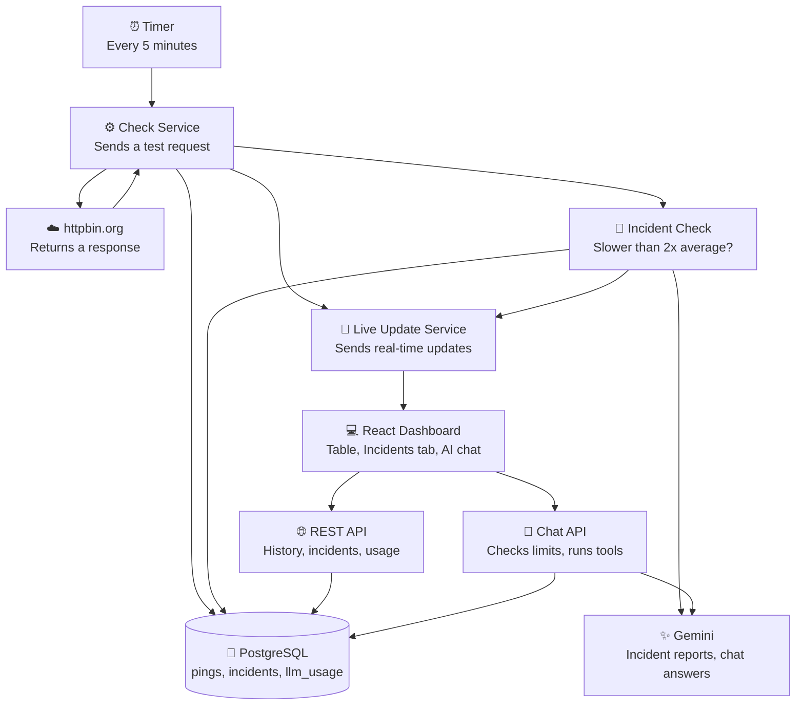

# HTTP Monitor

Pings `https://httpbin.org/anything` every 5 minutes with a random JSON payload, stores every result (including failures) in Postgres, and shows them on a dashboard that updates live.

**Live:** https://monitor.abdullahtech.me

> Status: core app, tests, CI, deployment and the AI enhancement (Option B, LLM-powered insights, cut down on purpose, see [AI enhancement](#ai-enhancement-option-b-llm-powered-insights)) are done.

**Contents:** [Features](#features) · [Architecture](#architecture) · [Tech choices](#tech-choices) · [Database schema](#database-schema) · [API](#api) · [Running locally](#running-locally) · [Deployment](#deployment) · [Testing strategy](#testing-strategy) · [AI enhancement](#ai-enhancement-option-b-llm-powered-insights) · [Assumptions](#assumptions) · [Trade-offs](#trade-offs-and-known-limitations) · [Future improvements](#future-improvements)

## Features

- Scheduled ping to httpbin every 5 minutes (configurable), with a random JSON body
- Every result saved: status code, response time, request payload, response body, error
- Failed pings (timeout, network error, non-2xx) are saved as rows, they never crash the job
- REST endpoint for history with page-based pagination
- Live updates over Server-Sent Events (new pings appear without a refresh)
- Dashboard: stats, table with expandable rows, pagination, loading / error / empty states, dark mode, works on mobile
- **AI chat**: ask questions about the data in plain English, answers stream in (Gemini)
- **Incidents tab**: a ping slower than 2x the 24h average opens an incident with an AI-written report
- **Cost controls**: max 20 LLM calls an hour, answer cache, token counting, cost shown on the dashboard
- **Shareable views**: the tab and page are in the URL (`?tab=incidents`, `?page=3`), and the back button works

## Architecture



### How to read it

1. Every 5 minutes, the timer starts a check.
2. The server sends a random JSON request to httpbin.
3. httpbin returns a response.
4. The server saves the result in PostgreSQL.
5. The server sends a live update to connected browsers using SSE.
6. The React dashboard displays the latest results.
7. The REST API loads historical results from PostgreSQL.
8. After each saved ping, the incident check compares it with the 24h average. If it's more than 2x slower, Gemini writes a report, it's saved, and browsers get an `incident` event.
9. The chat sends questions to the Chat API, which checks the limits and lets Gemini call two read-only database queries (tools) before answering.

When the page first opens, it loads older pings through the REST API (`GET /api/pings`). After that, new ones arrive through the live connection (SSE).

One deployment: a single Docker image where Express serves both the API and the built React app (see Deployment).

### Backend layers

```
server/src/
  routes/         which URL goes to which controller
  controllers/    HTTP in / HTTP out (read req, call a service, send res)
  services/       the actual work, no req/res
  repositories/   SQL only
  jobs/           when things run (the 5 minute timer)
  config/ db/ lib/ middleware/
```

| Layer | Does | Never does |
|---|---|---|
| routes | Maps a URL to a controller | Logic |
| controllers | Reads the request, calls a service, sends the response | SQL, calling httpbin |
| services | The real work | Touches `req` / `res` |
| repositories | SQL | Anything else |
| jobs | Decides *when* something runs | Decides *what* runs |

### Frontend

```
client/src/
  components/     UI (table, pagination, stats, Incidents list, chat widget, tool steps, AI usage line)
  hooks/          usePings, useLivePings (SSE), useAi (incidents + usage), useSearchParam (state in the URL)
  types/          Ping, Incident, AiUsage - same shapes as the API
  lib/            fetch wrapper, React Query client, date formatting
```

The table only reads from React Query's cache. History comes in through `GET /api/pings`; new pings from SSE are written into the cache for page 1. On reconnect the client refetches, so nothing is missed while it was offline.

The chat uses the AI SDK's `useChat` hook, which handles streaming and message state. The current tab and page live in the URL rather than in React state, so a link opens the same view.

## Tech choices

| Part | Choice | Why |
|---|---|---|
| Backend | Node + Express 5 + TypeScript | Preferred by the brief, small and easy to read |
| Database | Postgres (Neon) | Three small tables with fixed columns fit a relational DB; JSONB stores the payloads and report lists; free hosted tier. Free app hosts often wipe local disk, so SQLite was ruled out |
| DB access | `pg` with plain SQL | Three tables and a handful of queries. An ORM (Drizzle/Prisma) would add more than it saves here |
| Scheduler | `setInterval` in the server | The server is always running, so no external cron is needed |
| Live updates | Server-Sent Events | Data only flows server → browser. Plain HTTP, built-in browser reconnect, no extra library. WebSockets would be two-way, which we don't need |
| Frontend | React + Vite + TypeScript | Preferred by the brief |
| Data fetching | TanStack Query | Caching, loading/error states and refetching out of the box |
| Styling | Tailwind CSS | Fast to build a clean UI without a CSS file per component |
| Validation | zod | Env vars and query params checked in one place |
| Logging | pino + morgan | morgan logs each request in one line, pino logs app events (ping results, errors) with levels |
| LLM | Gemini Flash (`gemini-3.8-flash`) | Cheap and fast enough for lookups over small data. The model is an env var |
| LLM library | Vercel AI SDK (`ai`, `@ai-sdk/google`, `@ai-sdk/react`) | Tool loop, structured output and the streaming `useChat` hook out of the box. Switching provider is a one-line change |
| Token counting | `@google/genai` | Only for `countTokens`, which the AI SDK doesn't have |
| LLM rate limit | Count of `llm_usage` rows in the last hour | No extra library; survives restarts; the same table drives the cost display |

## Database schema

[`server/db/schema.sql`](server/db/schema.sql) - runs on startup, safe to run every time.

```sql
CREATE TABLE IF NOT EXISTS ping_results (
  id               SERIAL      PRIMARY KEY,
  created_at       TIMESTAMPTZ NOT NULL DEFAULT now(),
  ok               BOOLEAN     NOT NULL,
  status_code      INTEGER,               -- null on timeout / network error
  response_time_ms INTEGER     NOT NULL,
  request_payload  JSONB       NOT NULL,
  response_body    JSONB,
  error            TEXT
);
CREATE INDEX IF NOT EXISTS ping_results_created_at_idx ON ping_results (created_at DESC);

-- one row per Gemini call: the hourly limit and the cost display both count these
CREATE TABLE IF NOT EXISTS llm_usage (
  id            SERIAL        PRIMARY KEY,
  created_at    TIMESTAMPTZ   NOT NULL DEFAULT now(),
  kind          TEXT          NOT NULL,  -- 'chat' | 'incident'
  input_tokens  INTEGER       NOT NULL,
  output_tokens INTEGER       NOT NULL,
  cost_usd      NUMERIC(12,8) NOT NULL
);
CREATE INDEX IF NOT EXISTS llm_usage_created_at_idx ON llm_usage (created_at DESC);

-- a ping that took more than 2x the 24h average
CREATE TABLE IF NOT EXISTS incidents (
  id               SERIAL      PRIMARY KEY,
  created_at       TIMESTAMPTZ NOT NULL DEFAULT now(),
  ping_id          INTEGER     NOT NULL REFERENCES ping_results (id),
  endpoint         TEXT        NOT NULL,
  severity         TEXT        NOT NULL,  -- 'low' | 'medium' | 'high'
  response_time_ms INTEGER     NOT NULL,
  average_ms       INTEGER     NOT NULL,  -- the 24h average at the time
  summary          TEXT        NOT NULL,
  root_causes      JSONB       NOT NULL,  -- string[]
  recommendations  JSONB       NOT NULL,  -- string[]
  generated_by     TEXT        NOT NULL   -- 'llm' | 'template'
);
```

`average_ms` is stored on the incident because the average keeps moving; the report should show the number it was judged against.

## API

| Method | Path | Description |
|---|---|---|
| GET | `/api/health` | Liveness check |
| GET | `/api/pings?page=1&pageSize=10` | History, newest first. Returns `{ items, page, pageSize, total, totalPages }`. `pageSize` 1-100, default 10. Bad values return 400 |
| GET | `/api/pings/stream` | SSE stream. Each new ping is sent as `data: {...}`; a new incident as `event: incident` |
| POST | `/api/chat` | AI chat. Body `{ messages, timezone }` (AI SDK `useChat` format), streamed answer |
| GET | `/api/incidents` | Latest 50 incidents, newest first |
| GET | `/api/ai/usage` | LLM calls in the last hour vs the limits, tokens and estimated cost (24h and total) |

Errors always look like `{ "error": { "message": "..." } }`.

## Running locally

Requirements: Node 22+, Docker.

```bash
npm install
docker compose up -d                   # local Postgres on localhost:5433
cp server/.env.example server/.env     # already points at the local Postgres
# optional, for the AI chat and incident reports: set GEMINI_API_KEY in server/.env
npm run dev
```

Without `GEMINI_API_KEY` everything else works; the chat answers that it isn't configured and incidents get the template report.

Local dev uses its own database on purpose. If it shared the production one, both servers would write pings into the same table, and the live dashboard would show two pings every 5 minutes with mixed response times.

- Dashboard: http://localhost:5173
- API: http://localhost:3001

The tables are created automatically on first start.

### Environment variables

**server/.env**

| Name | Default | Notes |
|---|---|---|
| `DATABASE_URL` | - | Required. Locally the Docker Postgres; in production Neon with `sslmode=verify-full` |
| `PORT` | `3001` | |
| `CORS_ORIGIN` | `http://localhost:5173` | Frontend URL(s), comma-separated, no trailing slash |
| `PING_INTERVAL_MS` | `300000` (5 min) | Set to `10000` locally to watch live updates quickly |
| `GEMINI_API_KEY` | - | Optional. Without it the app runs normally; the chat says it isn't configured and incidents get the template report |
| `GEMINI_MODEL` | `gemini-3.8-flash` | Any Gemini text model |
| `GEMINI_INPUT_USD_PER_M` / `GEMINI_OUTPUT_USD_PER_M` | `0.3` / `2.5` | Price per 1M tokens, only for the cost display. Set them to the model's real price |
| `NODE_ENV` | `development` | |

**client/.env**

| Name | Default | Notes |
|---|---|---|
| `VITE_API_URL` | `http://localhost:3001` | Baked in at build time, so set it before `npm run build` |

## Deployment

One Docker image runs everything: Express serves the API under `/api` and the built React app on the same port. Same origin means no CORS setup and no `VITE_API_URL`.

```bash
docker build -t http-monitor .
docker run -d --restart unless-stopped -p 3001:3001 \
  -e DATABASE_URL="<neon url>" -e GEMINI_API_KEY="<key>" http-monitor
```

The host must keep the process running (a VM, not a scale-to-zero platform), because the 5 minute ping job and the SSE connections live inside it.

### Where it runs

Live at https://monitor.abdullahtech.me.

```
browser ──HTTPS──► Caddy (:443, Let's Encrypt cert) ──► app container (:3001) ──► Neon Postgres
                   └──────── GCP e2-small VM, Ubuntu 24.04 ────────┘
```

| Piece | Choice | Why |
|---|---|---|
| Compute | GCP Compute Engine e2-small (Ubuntu 24.04, us-central1) | Long-running process, so the timer and SSE never get paused |
| Database | Neon (managed Postgres) | No server to maintain; the pool reconnects after Neon suspends idle compute |
| HTTPS | Caddy container in front of the app | Gets and renews the certificate automatically |
| DNS | Cloudflare A record, DNS only (not proxied) | Keeps Caddy's certificate flow simple and SSE connections unaffected by Cloudflare's idle timeout |

Both containers use `--restart unless-stopped`, so they come back after a crash or a VM reboot. `DATABASE_URL` and `GEMINI_API_KEY` live in an env file on the VM, never in the image.

### Redeploying

There is no registry or CD yet. The image is built locally and copied over SSH:

```bash
docker build -t http-monitor .
docker save http-monitor | gzip > hm.tar.gz
scp hm.tar.gz <user>@<vm-ip>:~
ssh <user>@<vm-ip> 'gunzip -c hm.tar.gz | sudo docker load && sudo docker rm -f app && sudo docker run -d --name app --network hm --restart unless-stopped --env-file prod.env http-monitor'
```

## Testing strategy

Tools: Vitest.

```bash
npm test                # all tests
npm run test:coverage   # with coverage reports (server/coverage)
npm run lint
```

**Core parts of the app**

1. The check flow: call httpbin → save → broadcast
2. The history API (pagination, validation)
3. Live updates (SSE)

**Tested in depth: the check flow** (`httpbin.service` + `monitor.service`). It's the reason the app exists and it has the most ways to go wrong. httpbin, the database and SSE are faked, so the tests are fast and don't need the internet or a database.

| Case | Expected |
|---|---|
| httpbin returns 200 | `ok: true`, saved, broadcast |
| httpbin returns 500 | `ok: false`, still saved |
| no internet / timeout | `ok: false`, `statusCode: null`, error message kept, no throw |
| database is down | error logged, nothing broadcast, the job doesn't crash |
| paging maths | page 3 of size 10 skips 20 rows; 0 pings = 1 page |

**CI**: [GitHub Actions](.github/workflows/ci.yml) runs lint (oxlint), typecheck, tests and coverage on every push and PR, and uploads the coverage reports.

Not tested, to stay focused on the one core component: the API routes, SSE broadcasting, the React UI and the real database queries (would need a test Postgres).

**AI part**: only the incident rule (`classify`: more than 2x the average, severity steps, no incident with fewer than 5 samples) has unit tests. It's the one piece of AI-feature logic that is pure and decides something on its own. The chat and reports were checked by hand against the real Gemini API (answers, tool calls, cache hit, usage rows); testing LLM output properly would need an eval set, which is out of scope here.

## AI enhancement (Option B, LLM-powered insights)

### What was built, and what was cut

| Brief item | Status |
|---|---|
| 1. Chat over the monitoring data, "constructs database queries" | ✅ The model picks filters for 2 fixed queries (tools); it never writes SQL |
| 2. Automatic incident reports (> 2x average), stored, "Incidents" tab | ✅ |
| 3. Smart response analysis of httpbin payloads | ❌ Cut on purpose, see below |
| 4. Cost controls: token counting, cache, 20 calls/hour, fallback, cost display | ✅ |

**Why part 3 was cut**: httpbin `/anything` just echoes back what we sent, plus our own headers and IP. Every response has the same structure, so there are no real "patterns" or "categories" to find. An LLM summary of it would cost tokens on every ping and say the same thing each time. The time went into the parts that do something useful.

### How the chat works

```
useChat (React) ──POST /api/chat──► checks (see below) ──► streamText (AI SDK + Gemini)
                ◄── streamed answer ─┘                         │  model calls tools, up to 5 steps
                                                               ▼
                                          getStats(from, to)      findPings(from, to, onlyFailures, sortBy, limit)
                                                   └── fixed, parameterised SQL ──┘
```

- **Tools instead of text-to-SQL.** Letting an LLM write SQL against a public endpoint is an injection risk and is hard to make correct. Two fixed queries with typed parameters (zod) cover the example questions: "slowest today" is `findPings(sortBy: slowest)`, "summarise the last 24h" is `getStats` plus `findPings(onlyFailures)`, "why the spike at 2pm" is both, around 2pm.
- **It's a small agent**: the model decides which tools to call and can call several before answering. The loop is capped at 5 steps, and on the last step tools are switched off so it has to answer.
- **Timezone**: the browser sends its timezone, so "2pm" means the user's 2pm.
- Tool results leave out request/response bodies: they cost tokens and don't help answer questions about timing.

### How incident reports work

After each ping is saved: if it succeeded and took **more than 2x the median of successful pings in the last 24h** (needs at least 5 samples), an incident is opened. The median is used instead of the mean so that earlier slow pings don't raise the bar and hide later ones. Severity: low > 2x, medium > 3x, high > 4x.

The detection is plain maths; only the written report uses the LLM: one `generateText` call with a zod schema (structured output), given the slow ping and the last hour's stats. If the hourly limit is used up, or Gemini fails, a **template report** is saved instead, so an incident is never lost because of the LLM. The browser gets an `incident` SSE event and refreshes the tab.

### Cost controls

Checks on `POST /api/chat`, in order:

1. **Input limits**: question at most 500 characters, at most 50 messages accepted and only the **last 6 used**, and only their text (old tool results are dropped). The server doesn't store chats, so the browser sends the recent conversation with each question; the widget already sends only the last 6, but the server can't trust what a browser sends, so it checks again.
2. **Cache**: a first question (no conversation before it) is cached for 5 minutes, which is how often new data arrives. A cache hit uses **no** LLM call and doesn't count towards the limit. Follow-ups aren't cached because their answer depends on the conversation.
3. **Hourly limit**: the brief's 20 calls/hour, shared by chat and incident reports. Every Gemini call writes a row to `llm_usage`; before a call we count the rows from the last hour. Being in the database, the count survives restarts, and "the last hour" slides by itself, so nothing needs resetting. **Every Gemini call counts, not every question**: one question with tool calls is usually 2-3 calls, so the step cap is lowered to the calls left.
4. **Token count before the call**: Google's `countTokens` (`@google/genai`). The AI SDK has no pre-call counter, so this is the one place the Google SDK is used. Over 4,000 input tokens is refused. Counting is a separate, free endpoint: it doesn't run the model and doesn't count towards the hourly limit. If it fails, the size check is skipped (the hourly limit still caps the cost).

**Fallback when over the limit**: the chat answers with a fixed message ("used its hourly limit, back within the hour") streamed like a normal answer, so the widget handles it the same way. Incidents get the template report.

**Cost display**: tokens and cost from each call's usage are stored in `llm_usage`; the dashboard shows calls this hour vs the limit, tokens and estimated cost for the last 24h and in total.

### Cost analysis

Measured locally with `gemini-3.8-flash`:

| What | Gemini calls | Tokens | Cost* |
|---|---|---|---|
| One chat question (tools + answer) | 2-3 | ~2,500-3,000 | ~$0.0025 |
| One incident report | 1 | ~160 in (prompt) + output | < $0.001 |
| Same question again within 5 min | 0 (cache) | 0 | $0 |

*At the configured price of $0.30 / $2.50 per 1M input / output tokens. Gemini 3 models "think" before answering, and that thinking is billed as output tokens, which is why output is most of the cost.

**Worst case**: all 20 calls used every hour, all day: about 20 x $0.0012 ≈ **$0.025 an hour, ~$0.60 a day, ~$18 a month**. That's the ceiling the rate limit buys. Real use will be far lower: incidents are rare, and most visitors ask one of the suggested questions, which hit the cache.

What keeps it low, biggest effect first:

1. **The hourly cap**: a hard ceiling no matter how much traffic comes.
2. **A Flash model, not Pro**: the questions are simple lookups over a few hundred small rows. A Pro model would cost several times more for no visible gain.
3. **Small tool results**: no payload bodies, at most 20 rows.
4. **Trimmed history**: last 6 messages, text only. Without this, every follow-up resends all earlier tool results.
5. **The cache** for repeated first questions (the suggested questions are the same for everyone).
6. **Stable prompt prefix**: the fixed instructions come first and the current time last, so Gemini's automatic (implicit) caching can reuse the prefix.
7. **Thinking level `low`** (`THINKING_LEVEL` in `server/src/config/constants.ts`), measured below.

#### Thinking level: measured

Gemini 3 "thinks" before answering, and thinking is billed as output tokens. It was the main cause of 10-20 s answers, so the three suggested questions were asked once at the default level and once at `low` (same data, empty cache, `gemini-3.8-flash`):

| Question | Time | Gemini calls | Tokens | Cost |
|---|---|---|---|---|
| Slowest response times today | 14.1 → 10.7 s | 2 → 2 | 4,118 → 3,246 | $0.0046 → $0.0032 |
| Summarize issues, last 24h | 12.3 → 9.1 s | 2 → 3 | 3,775 → 4,376 | $0.0037 → $0.0045 |
| Why did it spike, last hour | 20.8 → 15.5 s | 2 → 3 | 5,514 → 6,602 | $0.0070 → $0.0060 |
| **Total** | **47.2 → 35.3 s (-25%)** | **6 → 8** | 13,407 → 14,224 | **$0.0152 → $0.0136 (-10%)** |

All six answers were correct and used sensible tools and time ranges. `low` was chosen because waiting time is what users notice. The cost of that choice: with less planning, the model sometimes takes one more tool round, so two questions used 3 calls instead of 2. That uses the 20-calls-an-hour limit a little faster (about 7-8 questions an hour instead of 10). One run per question is a small sample; LLM timings vary from run to run, so these numbers show a direction, not a precise saving. `minimal` was not used: the model still has to turn "today" or "2pm" into exact timestamps in the user's timezone, and that's where too little thinking would give wrong answers that look right.

### AI-specific trade-offs

- **The budget check isn't atomic**: two questions arriving at the same moment can both see "1 call left" and go 1-2 calls over. Fine at this traffic; a strict version would reserve calls in a transaction.
- **The cache is in memory**: it's lost on restart and not shared across instances (Redis would fix both). Only exact matches hit (after lower-casing and trimming); semantic matching would need embeddings, which cost calls too.
- **One shared limit, no per-visitor limit**: the site is public with no login, so one visitor can use up the hour's 20 calls. They can't raise the cost above the cap, and incidents then fall back to the template report. A per-IP limit was tried and removed: IPs are weak identities (VPNs, shared networks), and it added a dependency and proxy setup for little gain at this scale.
- **Chat and incidents share the 20**: a busy chat hour means incident reports use the template. Splitting the budget would avoid that, at the cost of one more rule to explain.
- **Token counting is an extra round trip** (~100-200 ms) per question. It's free on Google's side and the brief asks for it; without the requirement, the usage reported after the call would be enough.
- **The cost shown is an estimate**: it uses the configured price, not Google's bill.
- **The "why" answers are guesses**: the model only sees our measurements, not httpbin's servers. The prompt tells it to say so.

## Assumptions

- "Every 5 minutes" is measured from server start; one ping also runs on startup so a restart doesn't leave a gap.
- A ping counts as failed on timeout (10 s), network error or any non-2xx status.
- The "random JSON payload" has a fixed shape with random values (`id`, `value`, `active`, `sentAt`).
- One server instance. Broadcasting is in memory.
- Response times are measured from this server, so they depend on where it runs (locally it's ~700 ms, almost all of it 3 network round trips to httpbin's US servers).
- "Response time > 2x average" uses the average of **successful** pings in the last 24h (a 10 s timeout would distort it), needs at least 5 of them, and only judges successful pings. Failures already show in the table.
- "Max 20 LLM calls per hour" means 20 calls to Gemini in any rolling hour, counted per call (one question can be several), shared by everyone, since there are no user accounts.
- The chat only answers about this monitor's data. Questions like "why did it spike" get likely causes from our own measurements; we can't see httpbin's servers.
- Gemini prices are set in env vars; the dashboard's cost is an estimate from them, not Google's bill.

## Trade-offs and known limitations

- **Offset pagination**: a new ping shifts every row down by one, so in rare cases a row repeats when you move from page 2 to 3. Fine at one ping per 5 minutes. Live updates only touch page 1, so the page you're reading never jumps.
- **In-memory SSE clients**: running more than one server instance would need Redis pub/sub to broadcast across them.
- **Browser connection limit**: over HTTP/1.1 a browser allows 6 connections per domain, and each open tab keeps one for SSE. Not an issue over HTTP/2 in production.
- **No data retention**: the table grows forever (~288 rows a day).
- **Cloudflare proxy is off**: the VM's IP is public and has no DDoS shield in front of it. Turning the proxy on would only help if the firewall also accepted traffic from Cloudflare's IPs alone, and SSE would need a heartbeat to survive Cloudflare's 100 s idle timeout. Not worth it for a public demo with no private data; the LLM cost is already capped by the hourly limit.

## Future improvements

- Push images to a registry (e.g. GHCR) from CI and deploy on merge, instead of copying the image by hand
- Integration tests against a real Postgres (e.g. a Postgres service in CI)
- Delete or archive old rows after N days
- Charts of response time over time
- Alerts when pings fail several times in a row
- Monitor more than one URL
- SSE heartbeat if the host's proxy closes idle connections
- AI: an eval set of real questions to check answer quality when changing the prompt or model
- AI: reserve budget atomically; move the answer cache to Redis if there's ever more than one instance
- AI: group consecutive slow pings into one incident instead of one per ping
