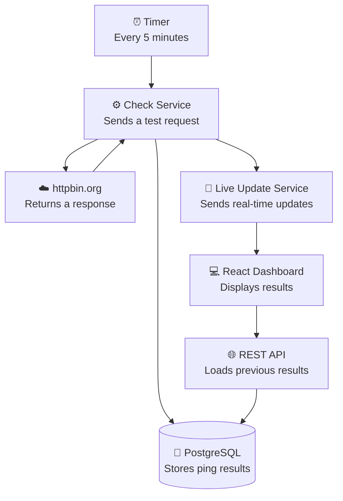

# HTTP Monitor

Pings `https://httpbin.org/anything` every 5 minutes with a random JSON payload, stores every result (including failures) in Postgres, and shows them on a dashboard that updates live.

**Live:** https://monitor.abdullahtech.me

> Status: core app, tests, CI and deployment done. The AI enhancement is still in progress.

## Features

- Scheduled ping to httpbin every 5 minutes (configurable), with a random JSON body
- Every result saved: status code, response time, request payload, response body, error
- Failed pings (timeout, network error, non-2xx) are saved as rows, they never crash the job
- REST endpoint for history with page-based pagination
- Live updates over Server-Sent Events (new pings appear without a refresh)
- Dashboard: stats, table with expandable rows, pagination, loading / error / empty states, dark mode, works on mobile

## Architecture



### How to read it

1. Every 5 minutes, the timer starts a check.
2. The server sends a random JSON request to httpbin.
3. httpbin returns a response.
4. The server saves the result in PostgreSQL.
5. The server sends a live update to connected browsers using SSE.
6. The React dashboard displays the latest results.
7. The REST API loads historical results from PostgreSQL.

When the page first opens, it loads older pings through the REST API (`GET /api/pings`). After that, new ones arrive through the live connection (SSE).

One deployment: a single Docker image where Express serves both the API and the built React app (see Deployment).

### Backend layers

```
server/src/
  routes/         which URL goes to which controller
  controllers/    HTTP in / HTTP out (read req, call a service, send res)
  services/       the actual work, no req/res
  repositories/   SQL only
  jobs/           when things run (the 5 minute timer)
  config/ db/ lib/ middleware/
```

| Layer | Does | Never does |
|---|---|---|
| routes | Maps a URL to a controller | Logic |
| controllers | Reads the request, calls a service, sends the response | SQL, calling httpbin |
| services | The real work | Touches `req` / `res` |
| repositories | SQL | Anything else |
| jobs | Decides *when* something runs | Decides *what* runs |

### Frontend

```
client/src/
  components/     UI (table, row, pagination, stats, status dot)
  hooks/          usePings (one page via React Query), useLivePings (SSE)
  types/          Ping, PingsPage - same shapes as the API
  lib/            fetch wrapper, React Query client, date formatting
```

The table only reads from React Query's cache. History comes in through `GET /api/pings`; new pings from SSE are written into the cache for page 1. On reconnect the client refetches, so nothing is missed while it was offline.

## Tech choices

| Part | Choice | Why |
|---|---|---|
| Backend | Node + Express 5 + TypeScript | Preferred by the brief, small and easy to read |
| Database | Postgres (Neon) | Relational fits one fixed table; JSONB stores the payloads; free hosted tier. Free app hosts often wipe local disk, so SQLite was ruled out |
| DB access | `pg` with plain SQL | One table and three queries. An ORM (Drizzle/Prisma) would add more than it saves here |
| Scheduler | `setInterval` in the server | The server is always running, so no external cron is needed |
| Live updates | Server-Sent Events | Data only flows server → browser. Plain HTTP, built-in browser reconnect, no extra library. WebSockets would be two-way, which we don't need |
| Frontend | React + Vite + TypeScript | Preferred by the brief |
| Data fetching | TanStack Query | Caching, loading/error states and refetching out of the box |
| Styling | Tailwind CSS | Fast to build a clean UI without a CSS file per component |
| Validation | zod | Env vars and query params checked in one place |
| Logging | pino + morgan | morgan logs each request in one line, pino logs app events (ping results, errors) with levels |

## Database schema

[`server/db/schema.sql`](server/db/schema.sql) - runs on startup, safe to run every time.

```sql
CREATE TABLE IF NOT EXISTS ping_results (
  id               SERIAL      PRIMARY KEY,
  created_at       TIMESTAMPTZ NOT NULL DEFAULT now(),
  ok               BOOLEAN     NOT NULL,
  status_code      INTEGER,               -- null on timeout / network error
  response_time_ms INTEGER     NOT NULL,
  request_payload  JSONB       NOT NULL,
  response_body    JSONB,
  error            TEXT
);
CREATE INDEX IF NOT EXISTS ping_results_created_at_idx ON ping_results (created_at DESC);
```

## API

| Method | Path | Description |
|---|---|---|
| GET | `/api/health` | Liveness check |
| GET | `/api/pings?page=1&pageSize=10` | History, newest first. Returns `{ items, page, pageSize, total, totalPages }`. `pageSize` 1-100, default 10. Bad values return 400 |
| GET | `/api/pings/stream` | SSE stream. Each new ping is sent as `data: {...}` |

Errors always look like `{ "error": { "message": "..." } }`.

## Running locally

Requirements: Node 22+, a Postgres database (a free [Neon](https://neon.tech) project works).

```bash
npm install
cp server/.env.example server/.env     # then set DATABASE_URL
npm run dev
```

- Dashboard: http://localhost:5173
- API: http://localhost:3001

The table is created automatically on first start.

### Environment variables

**server/.env**

| Name | Default | Notes |
|---|---|---|
| `DATABASE_URL` | - | Required. Postgres connection string, use `sslmode=verify-full` |
| `PORT` | `3001` | |
| `CORS_ORIGIN` | `http://localhost:5173` | Frontend URL(s), comma-separated, no trailing slash |
| `PING_INTERVAL_MS` | `300000` (5 min) | Set to `10000` locally to watch live updates quickly |
| `NODE_ENV` | `development` | |

**client/.env**

| Name | Default | Notes |
|---|---|---|
| `VITE_API_URL` | `http://localhost:3001` | Baked in at build time, so set it before `npm run build` |

## Deployment

One Docker image runs everything: Express serves the API under `/api` and the built React app on the same port. Same origin means no CORS setup and no `VITE_API_URL`.

```bash
docker build -t http-monitor .
docker run -d --restart unless-stopped -p 3001:3001 -e DATABASE_URL="<neon url>" http-monitor
```

The host must keep the process running (a VM, not a scale-to-zero platform), because the 5 minute ping job and the SSE connections live inside it.

### Where it runs

Live at https://monitor.abdullahtech.me.

```
browser ──HTTPS──► Caddy (:443, Let's Encrypt cert) ──► app container (:3001) ──► Neon Postgres
                   └──────── GCP e2-small VM, Ubuntu 24.04 ────────┘
```

| Piece | Choice | Why |
|---|---|---|
| Compute | GCP Compute Engine e2-small (Ubuntu 24.04, us-central1) | Long-running process, so the timer and SSE never get paused |
| Database | Neon (managed Postgres) | No server to maintain; the pool reconnects after Neon suspends idle compute |
| HTTPS | Caddy container in front of the app | Gets and renews the certificate automatically |
| DNS | Cloudflare A record, DNS only (not proxied) | Keeps Caddy's certificate flow simple and SSE connections unaffected by Cloudflare's idle timeout |

Both containers use `--restart unless-stopped`, so they come back after a crash or a VM reboot. `DATABASE_URL` lives in an env file on the VM, never in the image.

### Redeploying

There is no registry or CD yet. The image is built locally and copied over SSH:

```bash
docker build -t http-monitor .
docker save http-monitor | gzip > hm.tar.gz
scp hm.tar.gz <user>@<vm-ip>:~
ssh <user>@<vm-ip> 'gunzip -c hm.tar.gz | sudo docker load && sudo docker rm -f app && sudo docker run -d --name app --network hm --restart unless-stopped --env-file prod.env http-monitor'
```

## Testing strategy

Tools: Vitest.

```bash
npm test                # all tests
npm run test:coverage   # with coverage reports (server/coverage)
npm run lint
```

**Core parts of the app**

1. The check flow: call httpbin → save → broadcast
2. The history API (pagination, validation)
3. Live updates (SSE)

**Tested in depth: the check flow** (`httpbin.service` + `monitor.service`). It's the reason the app exists and it has the most ways to go wrong. httpbin, the database and SSE are faked, so the tests are fast and don't need the internet or a database.

| Case | Expected |
|---|---|
| httpbin returns 200 | `ok: true`, saved, broadcast |
| httpbin returns 500 | `ok: false`, still saved |
| no internet / timeout | `ok: false`, `statusCode: null`, error message kept, no throw |
| database is down | error logged, nothing broadcast, the job doesn't crash |
| paging maths | page 3 of size 10 skips 20 rows; 0 pings = 1 page |

**CI**: [GitHub Actions](.github/workflows/ci.yml) runs lint (oxlint), typecheck, tests and coverage on every push and PR, and uploads the coverage reports.

Not tested, to stay focused on the one core component: the API routes, SSE broadcasting, the React UI and the real database queries (would need a test Postgres).

## Assumptions

- "Every 5 minutes" is measured from server start; one ping also runs on startup so a restart doesn't leave a gap.
- A ping counts as failed on timeout (10 s), network error or any non-2xx status.
- The "random JSON payload" has a fixed shape with random values (`id`, `value`, `active`, `sentAt`).
- One server instance. Broadcasting is in memory.
- Response times are measured from this server, so they depend on where it runs (locally it's ~700 ms, almost all of it 3 network round trips to httpbin's US servers).

## Trade-offs and known limitations

- **Offset pagination**: a new ping shifts every row down by one, so in rare cases a row repeats when you move from page 2 to 3. Fine at one ping per 5 minutes. Live updates only touch page 1, so the page you're reading never jumps.
- **In-memory SSE clients**: running more than one server instance would need Redis pub/sub to broadcast across them.
- **Browser connection limit**: over HTTP/1.1 a browser allows 6 connections per domain, and each open tab keeps one for SSE. Not an issue over HTTP/2 in production.
- **No data retention**: the table grows forever (~288 rows a day).

## Future improvements

- Push images to a registry (e.g. GHCR) from CI and deploy on merge, instead of copying the image by hand
- Integration tests against a real Postgres (e.g. a Postgres service in CI)
- Delete or archive old rows after N days
- Charts of response time over time
- Alerts when pings fail several times in a row
- Monitor more than one URL
- SSE heartbeat if the host's proxy closes idle connections
